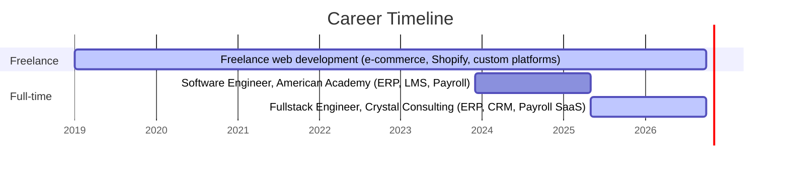

 

📍 Cairo, Egypt · 🌐 Arabic & English · 💼 Open to senior full-stack & technical-lead roles

---

## 🧑‍💻 About

**Fullstack Software Engineer** with **7+ years of experience** (freelance since 2019, full-time since 2023) designing, building and operating **scalable enterprise systems**.

I work end to end: architecture and database design, backend APIs and integrations, frontend delivery, cloud deployment and CI/CD. My sweet spot is **business-critical systems**: ERP, CRM, LMS, inventory and **payroll**, where correctness, security and uptime matter.

Currently **technical lead and product owner** on a multi-tenant SaaS payroll platform, responsible for architecture, integrations and delivery.

---

## ⚡ Core Capabilities

| Area | What I deliver |
|---|---|
| **Full-stack development** | MERN, Next.js, TypeScript, Laravel, Python/Django, REST & API-first design |
| **Enterprise systems** | ERP, CRM, LMS, payroll, inventory, procurement and reporting platforms |
| **Integrations** | Oracle HCM and SQL Server integrations, AI-agent and automation workflows |
| **Databases** | Oracle, SQL Server, PostgreSQL, MySQL, MongoDB: schema design and query optimization |
| **Cloud & DevOps** | AWS, GCP, Heroku, Firebase, Ubuntu & Windows Server, CI/CD pipelines |
| **Security & reliability** | Secure coding, identity management, performance tuning, 99% uptime on production systems |
| **E-commerce & CMS** | Shopify and WooCommerce builds, WordPress, custom storefronts |
| **Automation & data** | Excel-based procurement and project-tracking tools, AI/ML solutions (TensorFlow, scikit-learn) |
| **Delivery** | Agile/Scrum, backlog and story mapping, cross-functional collaboration, 100% on-time delivery record |

---

## 📈 Impact in Numbers

| Metric | Result |
|---|---|
| Manual workload reduced via AI-powered automation | **30%** |
| Fewer deployment issues after CI/CD rollout | **25%** |
| Production uptime on enterprise systems | **99%** |
| Projects delivered on time under Agile workflows | **100%** |
| Performance gain from legacy-codebase optimization | **20–30%** |
| Hackathon podiums (GDSC, Arabic Open, Smart Government) | **3 wins** |

---

## 🗺️ Career Timeline

---

## 🚀 Featured Projects

| Project | Summary | Stack |
|---|---|---|
| **[Gatexam.org](https://gatexam.org/)** | Online exam system serving thousands of users | MERN, MySQL |
| **[TalentTrackedu.com](https://talenttrackedu.com/)** | Training portal with CRM-integrated dashboards | Web, CRM integration |
| **[LMS](https://lms.americanacademyeg.com/)** | Online classes and exam platform | Web platform |
| **[Inventory System](https://inventory.americanacademyeg.com/)** | Stock, suppliers and finance management | Web, reporting |
| **[Americanacademyeg.com](https://americanacademyeg.com/)** | ERP and Moodle-integrated institutional portals | ERP, Moodle |
| **[Eduvisioneg.com](https://eduvisioneg.com/)** | E-learning portal for course management | E-learning |
| **[Gom3a.com](https://gom3a.com/)** | WooCommerce e-commerce store | WooCommerce, WordPress |
| **Multi-tenant SaaS Payroll Platform** | Automated payroll with Oracle HCM as source of truth | Laravel, Node.js, Oracle HCM |
| **Payroll System (on-prem)** | Automated HR & payroll with secure on-premises deployment | Enterprise, on-prem |

---

## 🛠️ Technical Stack

  

| Category | Technologies |
|---|---|
| **Languages** | JavaScript, TypeScript, Python, PHP, C++, C#, HTML, CSS |
| **Frameworks** | MERN, Next.js, Node.js / Express, Laravel, Django, Bootstrap |
| **Databases** | Oracle, SQL Server, PostgreSQL, MySQL, MongoDB |
| **Cloud & DevOps** | AWS, Google Cloud, Heroku, Firebase, CI/CD, Ubuntu, Windows Server |
| **AI & Data** | TensorFlow, scikit-learn, AI agent integration, workflow automation |
| **Practices** | REST API design, secure coding, identity management, Agile/Scrum, Git |

---

## 🎓 Education & Development

- **B.Sc. Computer Science**, Obour Institutes, Cairo (2023). Graduation project: *Excellent*. Overall: *Very Good*.
- **ITI Agile Development Course** (2022): Agile principles, backlog management, story mapping.
- **FreeCodeCamp Full-Stack Web Development** (2022–2023): React, Node.js, MongoDB.

---

## 🏆 Honors & Achievements

- 🥇 **1st Place**: GDSC & GDG Hackathon (2023)
- 🥇 **1st Place**: Arabic Open Hackathon (2023)
- 🥉 **3rd Place**: Smart Government Hackathon (2023)
- 🌍 **9th Place Globally**: IEEE IC-SIT (2023)
- ⭐ **Best Member**: GDSC OI (2023)
- 🎓 **ATEC Scholarship Recipient** (2021)
- 📖 Volunteer, Cairo International Book Fair (2020)

---

## 📊 GitHub Activity

  
  

  

  

---

## 🤝 Let's Connect

I'm always happy to talk about **enterprise systems, payroll and HR platforms, integrations, or technical leadership**. The best way to reach me is email.

📧 [alirekg@gmail.com](mailto:alirekg@gmail.com) · 🔗 [LinkedIn](https://www.linkedin.com/in/alitarekg/) · 🌐 [Portfolio](https://equlify.store/)

