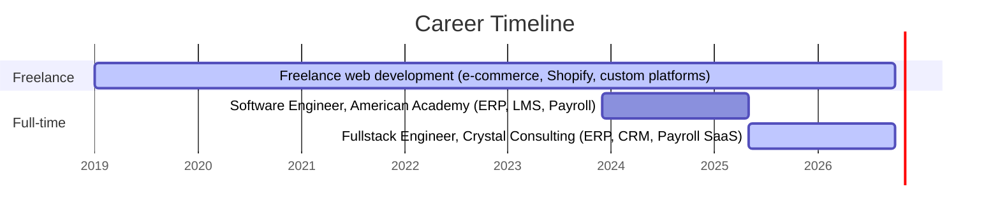

# Hi, I'm Ali Tarek 👋

**Fullstack Software Engineer** · ERP · Payroll · LMS · Integrations

📍 Cairo, Egypt · 🌐 Arabic & English · 💼 Open to senior full-stack & technical-lead roles

---

## 🛠️ Technical Stack

  

| Category | Technologies |
|---|---|
| **Languages** | JavaScript, TypeScript, Python, PHP, C++, C#, HTML, CSS |
| **Frameworks** | MERN, Next.js, Node.js / Express, Laravel, Django, Bootstrap |
| **Databases** | Oracle, SQL Server, PostgreSQL, MySQL, MongoDB |
| **Cloud & DevOps** | AWS, Google Cloud, Heroku, Firebase, CI/CD, Ubuntu, Windows Server |
| **AI & Data** | TensorFlow, scikit-learn, AI agent integration, workflow automation |
| **Practices** | REST API design, secure coding, identity management, Agile/Scrum, Git |

---

## 🧑‍💻 About

**Fullstack Software Engineer** with **7+ years of experience** (freelance since 2019, full-time since 2023) designing, building and operating **scalable enterprise systems**.

I work end to end: architecture and database design, backend APIs and integrations, frontend delivery, cloud deployment and CI/CD. My sweet spot is **business-critical systems**: ERP, CRM, LMS, inventory and **payroll**, where correctness, security and uptime matter.

Currently **technical lead and product owner** on a multi-tenant SaaS payroll platform, responsible for architecture, integrations and delivery.

---

## ⚡ Core Capabilities

| Area | What I deliver |
|---|---|
| **Full-stack development** | MERN, Next.js, TypeScript, Laravel, Python/Django, REST & API-first design |
| **Enterprise systems** | ERP, CRM, LMS, payroll, inventory, procurement and reporting platforms |
| **Integrations** | Oracle HCM and SQL Server integrations, AI-agent and automation workflows |
| **Databases** | Oracle, SQL Server, PostgreSQL, MySQL, MongoDB: schema design and query optimization |
| **Cloud & DevOps** | AWS, GCP, Heroku, Firebase, Ubuntu & Windows Server, CI/CD pipelines |
| **Security & reliability** | Secure coding, identity management, performance tuning, 99% uptime on production systems |
| **E-commerce & CMS** | Shopify and WooCommerce builds, WordPress, custom storefronts |
| **Automation & data** | Excel-based procurement and project-tracking tools, AI/ML solutions (TensorFlow, scikit-learn) |
| **Delivery** | Agile/Scrum, backlog and story mapping, cross-functional collaboration, 100% on-time delivery record |

---

## 📈 Impact in Numbers

| Metric | Result |
|---|---|
| Manual workload reduced via AI-powered automation | **30%** |
| Fewer deployment issues after CI/CD rollout | **25%** |
| Production uptime on enterprise systems | **99%** |
| Projects delivered on time under Agile workflows | **100%** |
| Performance gain from legacy-codebase optimization | **20–30%** |
| Hackathon podiums (GDSC, Arabic Open, Smart Government) | **3 wins** |

---

## 🚀 Featured Projects

### 🌍 Live Products

| Project | What it does | Stack | Highlights |
|---|---|---|---|
| **[InnerAI](https://anatomy-eight-drab.vercel.app)** (2026) | Explore the human body in 3D and ask an AI to explain what you're looking at | Next.js, React, WebGL, Tailwind, LLM | 3D anatomy · AI explanations · EN/AR with RTL |
| **[Hapipy](https://hapipy.com)** (2026) | A private, password-protected space for two: love letters, memories and milestones | React, Firebase Auth, Firestore, PWA | Real-time shared timeline · installable PWA |
| **[TalentTrack](https://talenttrackedu.com)** (2021) | Training portal with CRM, course delivery, payments and progress tracking | React, Node.js, MongoDB, CRM APIs | 10K+ learners · +40% course completion · 70% admin automated |
| **[Commercial Lighting Orlando](https://www.commerciallightingorlando.com/)** (2025) | CRM-driven lead capture, scheduling and customer records for an electrical services company | Next.js, React, Node.js, REST, CRM, SEO | Server-rendered for local SEO · lead-to-job pipeline · mobile-first |
| **[Ahmed-Hub Store](https://ahm-designs.web.app/)** (2024) | Serverless storefront with a real-time catalogue and checkout | React, Firebase, Firestore, Hosting | Real-time catalogue sync · zero-ops infrastructure |
| **[Gatexam](https://gatexam.org)** (2023) | Online examination platform with AI proctoring and auto-grading | React, Node.js, Express, MySQL, WebSockets, TensorFlow | 5K+ concurrent students · 85% less grading time · real-time AI proctoring |

### 🏢 Enterprise & Client Work

Built for clients and internal deployments, so these are not publicly linked.

| Project | What it does | Stack | Highlights |
|---|---|---|---|
| **American Academy ERP** (2022–2025) | HR, finance, operations and attendance unified in one system | Next.js, TypeScript, Node.js, Oracle, Redis, Docker | 8 departments unified · 99.5% uptime · 60% faster processing |
| **American Academy LMS** (2022–2024) | Live classes, assessments and student portals at academy scale | MongoDB, Express, React, Node.js, Moodle | Live class streaming · auto assessment scoring · per-student analytics |
| **Inventory & Procurement** (2023) | Stock, suppliers, procurement and finance in a single ledger | Node.js, Express, SQL Server, React | Real-time stock tracking · full audit trail |
| **Payroll & HR Automation** (2023) | Payroll, leave and HR records on secure on-premise servers | MongoDB, Express, React, Node.js, Windows Server | Zero-touch monthly payroll · full leave workflow |
| **Corporate Academy Portals** (2022–2024) | Branded corporate portals wired into ERP and Moodle backends | Next.js, Node.js, SSO, Moodle, REST | Single sign-on across three backends · per-client dashboards |
| **Multi-tenant SaaS Payroll Platform** (2025–Present) | Automated payroll with Oracle HCM as the source of truth. I lead architecture and delivery as technical lead | Laravel, Node.js, Oracle HCM | Multi-tenant · HCM integration · product ownership |

### 📦 Archived

| Project | What it was | Stack |
|---|---|---|
| **Gom3a Commerce** (2020) | High-performance WooCommerce storefront, speed-tuned end to end | WooCommerce, PHP, MySQL |

---

## 🗺️ Career Timeline

---

## 🎓 Education & Development

- **B.Sc. Computer Science**, Obour Institutes, Cairo (2023). Graduation project: *Excellent*. Overall: *Very Good*.
- **ITI Agile Development Course** (2022): Agile principles, backlog management, story mapping.
- **FreeCodeCamp Full-Stack Web Development** (2022–2023): React, Node.js, MongoDB.

---

## 🏆 Honors & Achievements

- 🥇 **1st Place**: GDSC & GDG Hackathon (2023)
- 🥇 **1st Place**: Arabic Open Hackathon (2023)
- 🥉 **3rd Place**: Smart Government Hackathon (2023)
- 🌍 **9th Place Globally**: IEEE IC-SIT (2023)
- ⭐ **Best Member**: GDSC OI (2023)
- 🎓 **ATEC Scholarship Recipient** (2021)
- 📖 Volunteer, Cairo International Book Fair (2020)

---

## 📊 GitHub Activity

  
  

  

  

